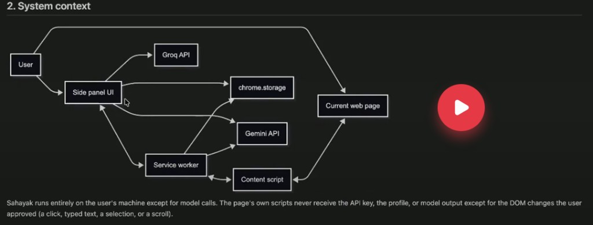
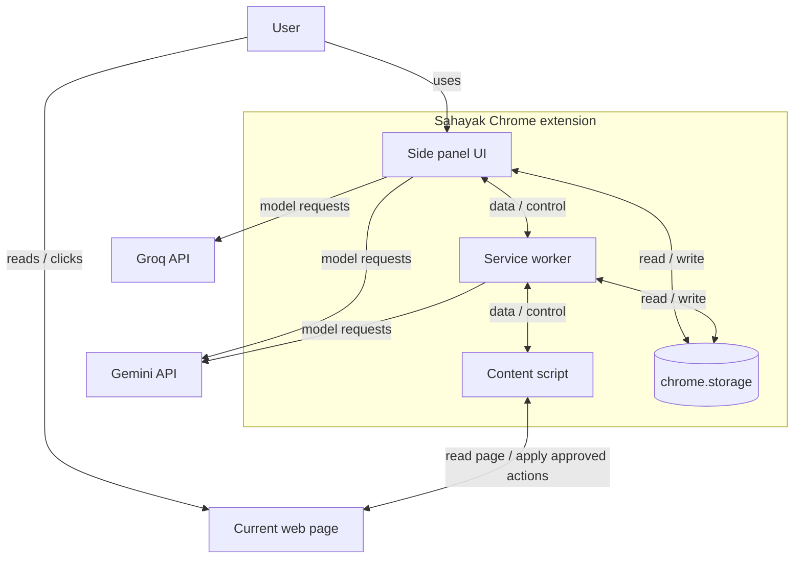
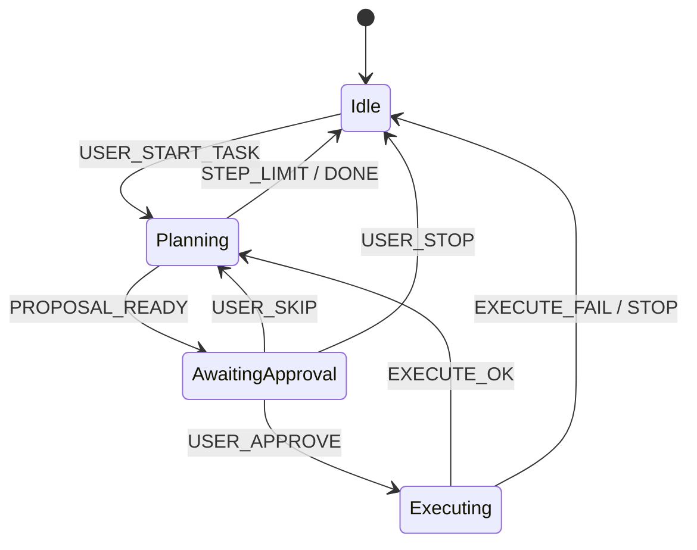
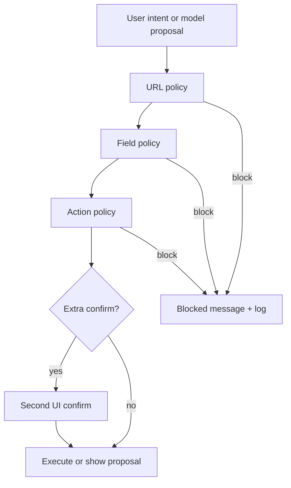

# Sahayak — System Architecture

This document records high-level technical decisions for building **Sahayak**, a Chrome side-panel AI agent that reads the active page, reasons over content and interactive elements, and executes browser actions only after explicit user approval. It complements [problem-statement.md](./problem-statement.md) and should be read before [implementation-plan.md](./implementation-plan.md).

---

## 1. Architectural principles

| Principle | Implication |
|-----------|-------------|
| **User in the loop** | No autonomous clicks, typing, or navigation. Every agent step is propose → approve → execute. |
| **Ground truth from the browser** | Page text, DOM action maps, and screenshots come from extension APIs and content scripts—not from model guesses. |
| **Safety in code** | URL/field/action blocklists and confirmation gates are enforced in TypeScript before any DOM mutation. |
| **Local-first memory** | Profile and skills live in `chrome.storage.local`; API keys never ship in the repo. |
| **Free-tier resilience** | Default to lightweight models; escalate only when needed; retry and fallback without crashing the UI. |
| **Vertical slices** | Ship end-to-end features (UI → messaging → worker → content script) per week, not layers in isolation. |
| **Host-page isolation** | The open web page never receives API keys, profile, skills, or raw model output—only user-approved DOM effects. |

---

## 2. System context

The canonical topology for Sahayak matches the diagram below: the **user** works in the **side panel** and on the **current web page**; the panel talks to **chrome.storage** and both AI providers; the **service worker** coordinates page access, persistence, and Gemini calls that must run without the panel; the **content script** is the only bridge into the page DOM.





**Trust boundary (required behaviour)**

Sahayak runs on the user’s machine except for external model API calls. The **host page’s own JavaScript must never receive** API keys, user profile, saved skills, conversation history, or direct model output. The page may change only through **user-approved** extension actions—for example an approved click, typed text, selection highlight, or scroll performed by the content script after the safety pipeline passes.

**Roles**

| Component | Responsibility |
|-----------|----------------|
| **Side panel UI** | Primary UX—chat, summaries, settings, skills, agent approval UI, action log. Reads/writes **chrome.storage** (keys, profile, preferences). Calls **Gemini** and **Groq** for user-initiated text tasks (chat, explain, translate, draft, summaries) using keys loaded from storage. Sends **data / control** messages to the service worker for anything that needs tabs, capture, or DOM access. |
| **Service worker** | Background orchestration—context menus, `captureVisibleTab`, agent FSM, rate-limit coordination, session persistence when the panel is closed or sleeping. Reads/writes **chrome.storage**. Calls **Gemini** for worker-owned flows (agent next-step, find-element JSON, vision payloads assembled after capture, context-menu handoff when the panel is not active). Does **not** call Groq in this topology (Groq is panel-side text fallback). |
| **Content script** | Isolated from page JS. Reads DOM/text/action maps; injects badges and highlights; executes **approved** actions only. Never calls external APIs or reads storage. |
| **Current web page** | Untrusted environment. Source of Readability input and action-map targets; recipient only of approved DOM mutations. |
| **chrome.storage** | Local-only: API keys, profile, skills, language, agent checkpoints. Never exposed to the page context. |
| **Groq API** | Text-only fallback from the **side panel** when Gemini quota/errors block a panel-initiated text task. |
| **Gemini API** | Primary provider—from **side panel** (most features) and **service worker** (capture/agent/background Gemini work). Public YouTube URL input when supported. |

**Why both panel and worker call Gemini**

Extension pages (side panel) may call Gemini directly with the user’s key—same as the diagram. The service worker additionally calls Gemini when the workflow originates in the background (tab capture → vision question, agent step while coordinating with content script, or opening the panel after a context-menu action with a prefetched prompt). Shared **`AIRouter`** logic lives in `src/shared/ai/` and is imported by both bundles so routing, retries, and model tiers stay consistent.

---

## 3. Extension topology (Manifest V3)

### 3.1 Entry points

| Surface | Responsibility |
|---------|----------------|
| `manifest.json` | Permissions, side panel default path, service worker, content script matches, optional host permissions for practice sites |
| Side panel (`sidepanel.html` + bundle) | React or vanilla SPA; all user-facing flows |
| Service worker (`background.ts`) | Tab/capture/menus, agent FSM, Gemini for worker-owned flows; survives sleep via persisted agent state |
| Content script (`content.ts`) | Isolated world; DOM read/write on matched URLs |
| Options / settings | Either dedicated options page or in-panel settings tab (single settings source of truth) |

### 3.2 Recommended permissions (minimal)

- `sidePanel`, `storage`, `activeTab`, `scripting`, `contextMenus`, `tabs` (for capture and tab metadata).
- **Host permissions**: Prefer **`activeTab`** + **`scripting.executeScript`** on user gesture over `<all_urls>` where possible. For agent practice environments, add explicit host patterns (e.g. cohort-provided demo domains).
- **Never** request broad permissions “for convenience”; document each permission in README.

### 3.3 Build and module shape

- **Language**: TypeScript throughout (content, background, side panel).
- **Bundler**: Vite or esbuild producing separate bundles: `sidepanel.js`, `background.js`, `content.js`.
- **Shared package**: `src/shared/` for message types, JSON schemas, safety rules, and prompt fragments—imported by all contexts (no DOM APIs in shared code).

```
sahayak/
├── manifest.json
├── src/
│   ├── background/       # SW: agent FSM, menus, capture, Gemini calls
│   ├── content/          # Scanner, badges, executor, readability runner (no storage / no APIs)
│   ├── sidepanel/        # UI, streaming, chrome.storage, Gemini + Groq calls
│   └── shared/
│       ├── messages.ts   # Discriminated union for runtime messages
│       ├── schemas/      # Zod or JSON Schema for agent + find-it JSON
│       ├── safety/       # URL + field + action policy
│       ├── ai/           # Provider interfaces, model tiers
│       └── types/
├── assets/
└── docs/
```

---

## 4. Inter-process communication (IPC)

Use **`chrome.runtime.sendMessage`** / **`chrome.runtime.connect`** (for streaming) with a **typed discriminated union** in `shared/messages.ts`. Every message includes `requestId` for correlation and error replies.

### 4.1 Message categories

| Category | Examples | Handler |
|----------|----------|---------|
| **Page context** | `GET_PAGE_ARTICLE`, `GET_PAGE_TEXT_SNAPSHOT`, `GET_ACTION_MAP` | Content script |
| **Visual** | `CAPTURE_VISIBLE_TAB` | Service worker (`chrome.tabs.captureVisibleTab`) |
| **AI (panel)** | `SUMMARIZE_ARTICLE`, `CHAT_PAGE`, `EXPLAIN_SELECTION` (after page text fetched via SW/CS) | Side panel → Gemini / Groq |
| **AI (worker)** | `AGENT_NEXT_STEP`, `FIND_ELEMENT`, vision after `CAPTURE_VISIBLE_TAB` | Service worker → Gemini |
| **Agent control** | `AGENT_APPROVE`, `AGENT_SKIP`, `AGENT_STOP`, `AGENT_DRY_RUN` | Service worker + content |
| **Execute** | `EXECUTE_ACTION` | Content script (after SW safety pass) |
| **Storage** | `GET_PROFILE`, `SAVE_SKILL`, etc. | SW or panel via `chrome.storage` directly |

### 4.2 Tab binding

All page operations target **`tabId`** from the current window’s active tab when the side panel opened or when the user explicitly “pins” context. On tab switch, panel shows a banner: “Context switched—refresh page context” to avoid stale chat/action maps.

### 4.3 Streaming

For chat and long summaries initiated in the panel, stream from **`fetch`/provider SDK inside the side panel** (or a panel-owned worker port for UI threading). For agent/vision steps, the panel sends **data / control** to the service worker; the worker calls Gemini and returns structured results or streams chunks via **`chrome.runtime.connect`**. Fallback: panel-side Groq only for eligible text tasks.

---

## 5. AI layer architecture

### 5.1 Provider abstraction

```typescript
interface TextProvider {
  complete(params: TextRequest): Promise<TextResponse>;
  stream?(params: TextRequest): AsyncIterable<string>;
}

interface VisionProvider {
  completeWithImage(params: VisionRequest): Promise<TextResponse>;
}
```

Implementations:

- **`GeminiTextProvider`**: Flash-Lite default; Flash for harder tasks.
- **`GeminiVisionProvider`**: Flash for screenshot Q&A.
- **`GroqTextProvider`**: Fallback when Gemini returns 429/5xx and task is text-only (no image, no strict JSON agent step if Groq cannot reliably follow schema—see below).

### 5.2 Model routing policy

| Task | Default model | Escalation trigger |
|------|---------------|-------------------|
| Explain / translate selection | Flash-Lite | User toggles “better quality” or repeated user retry |
| Article / YouTube summary | Flash-Lite | Long document or poor structured output → Flash |
| Grounded page chat | Flash-Lite | Multi-hop reasoning failures (optional) |
| Screenshot Q&A | Flash | Always vision-capable |
| Agent next step / find element | Flash | Strict JSON validation failures (max N retries) |

Routing lives in shared **`AIRouter`** (`src/shared/ai/router.ts`), invoked from the **side panel** (Gemini + Groq) and **service worker** (Gemini only): `route(taskType, payload, { caller: 'panel' | 'worker' })` returns provider + model id.

### 5.3 Resilience

- **429 / quota**: Exponential backoff with jitter; cap retries; surface “try again in Xs” in UI.
- **Fallback chain**: Gemini Lite → Gemini Flash → Groq (text only) → user-visible error with actionable text.
- **Timeouts**: AbortController per request; don’t block SW indefinitely.
- **Structured output**: Agent and find-it responses parsed with **Zod**; on failure, retry once with “JSON only” system reminder; never execute on invalid JSON.

### 5.4 Prompt and context assembly

Centralize in `shared/prompts/`:

- **System**: Role, language (English / Hinglish), grounding rules (“answer only from provided context”).
- **User content**: Assembled packages—never send full raw HTML to the model for chat; send Readability output + optional metadata (title, URL).
- **Agent**: Compact action map JSON only (see §7).
- **Secrets**: API keys read from storage at call time; never logged.

### 5.5 YouTube summarisation

- Input: public watch URL from user or current tab.
- Path: Gemini API feature that accepts YouTube URL when supported; otherwise fetch page title/description only and inform user of limitation.
- Output schema: same TL;DR / key points / next steps; optional `{ timestamp, label }[]` rendered as links `https://youtube.com/watch?v=ID&t=Ns`.

### 5.6 Article extraction

- Run **Mozilla Readability** in content script (or injected isolated bundle) on `document.cloneNode(true)`.
- Return `{ title, byline, excerpt, textContent, siteName, length }` via service worker relay to the side panel (content script never sends this to the host page).
- Summarisation prompt uses structured output template matching problem statement (TL;DR, 5 bullets, what to do next).

---

## 6. Side panel application architecture

### 6.1 UI modules (feature-based)

| Module | Concerns |
|--------|----------|
| **Shell** | Layout, tab switch awareness, connection status to SW |
| **Chat** | Message list, streaming, grounded citations optional (quote spans from page text) |
| **Summarize** | Trigger from current tab; language toggle |
| **Quick actions** | Explain / translate / draft—also triggered from context menu via SW → panel route |
| **Screenshot** | Crop overlay optional (phase 2: full tab capture first); question input |
| **Agent** | Task input, proposed step card, Approve / Skip / Stop, dry-run toggle, step counter |
| **Find it** | NL query → highlight element number |
| **Memory** | Profile editor, skills list, import/export file |
| **Settings** | Gemini key, optional Groq key, language default, max agent steps |
| **Action log** | Append-only list for current session + persisted task id |

### 6.2 State management

- **React**: Context + reducers or Zustand for panel-only UI state.
- **Agent FSM state**: Authoritative copy in **service worker** + mirror in panel for display; panel sends intents only.
- **Conversation**: Per-tab session id in memory; optional persist last N turns in `sessionStorage` inside panel for refresh resilience.

### 6.3 Language toggle

- Global preference in storage: `outputLanguage: 'en' | 'hinglish'`.
- Passed into every AI request as system instruction block (romanized Hinglish definition for consistency).

---

## 7. Page understanding and action map

### 7.1 Interactive element scanner (content script)

**Goal**: Produce a stable, numbered list of actionable elements for the current DOM snapshot.

**Detection strategy** (ordered):

1. Native controls: `button`, `a[href]`, `input`, `textarea`, `select`, `summary`, `[role=button]`, `[role=link]`, `[role=checkbox]`, `[role=combobox]`.
2. Filter: not `disabled`, not `aria-hidden`, reasonably visible (bounding rect area > threshold, `visibility`, `display`).
3. De-duplicate: nested clickable → prefer outermost or innermost consistently (document choice: **prefer innermost actionable** for precision).
4. Assign **`elementId`**: integer 1..N in DOM traversal order (top-to-bottom, left-to-right).

**Element record** (sent to model, not full DOM):

```json
{
  "id": 12,
  "role": "button",
  "tag": "BUTTON",
  "name": "Submit application",
  "placeholder": null,
  "inputType": null,
  "href": null,
  "approximatePosition": "lower-right"
}
```

Do **not** include password field values or innerHTML blobs.

### 7.2 Visual badges

- Overlay layer: shadow DOM or fixed `div#sahayak-overlay` injected by content script.
- Badges positioned from `getBoundingClientRect()`; update on scroll/resize (throttled `requestAnimationFrame`).
- Toggle: user can hide badges to reduce clutter; agent mode turns them on when task starts.

### 7.3 Action map refresh

- Refresh on: agent step after execution, manual “Refresh map”, SPA navigation (`MutationObserver` + debounce).
- **Version** field `mapVersion` increments; SW rejects execute if panel approves stale id (race guard).

---

## 8. Agent architecture (approval-based loop)

### 8.1 Finite state machine (service worker)



**Persisted snapshot** (storage key `agentSession:{tabId}`):

- `taskDescription`, `stepCount`, `maxSteps`, `status`, `pendingProposal`, `actionLog[]`, `mapVersion`, `updatedAt`.

On SW wake, panel loads snapshot and restores UI.

### 8.2 Proposal schema (strict JSON)

```typescript
type AgentAction =
  | { type: 'click'; targetId: number; reason: string }
  | { type: 'type'; targetId: number; value: string; reason: string }
  | { type: 'select'; targetId: number; value: string; reason: string }
  | { type: 'scroll'; direction: 'up' | 'down'; amount: 'page' | 'half'; reason: string }
  | { type: 'done'; reason: string };
```

Validation steps:

1. JSON parse + Zod validate.
2. **`SafetyEngine.evaluate(proposal, actionMap, tabUrl)`** → allow | block | requireExtraConfirm.
3. If `type` requires `targetId`, ensure id exists in current map and element is not blocked (password, OTP, payment).

### 8.3 Execution (content script)

| Action | Implementation |
|--------|----------------|
| `click` | Resolve element by id map; `element.click()` or dispatch trusted-like events if needed |
| `type` | Focus, clear policy (select-all + delete), insert value, **no** typing into blocked types |
| `select` | Set `value` + dispatch `change` |
| `scroll` | `window.scrollBy` or scrollable ancestor |
| `done` | SW transitions to Idle; no DOM op |

**Dry-run**: Resolve element, pulse highlight, no click/type.

### 8.4 Find-it-for-me (no execution)

- Same action map; model returns `{ "targetId": number, "reason": string }` only.
- Content script highlights badge + scroll into view.

### 8.5 Practice task scope

- Agent automation enabled only on **allowlisted origins** (config `PRACTICE_ORIGINS` + user-owned domains flag off by default).
- Combined with banking/payment URL blocklist (§9).

---

## 9. Safety architecture

Safety is a **pipeline**, not a prompt footnote.



### 9.1 URL policy

- Block agent **execution** (not necessarily read-only summarise) on URL patterns: banking, payment, UPI, wallet, crypto exchange (maintain list in `shared/safety/url-blocklist.ts` with tests).
- Sensitive read policy: optional warning before sending page text to cloud on known categories (configurable).

### 9.2 Field policy

- Never `type` into: `input[type=password]`, OTP-like fields (heuristics: `autocomplete=one-time-code`, name/id regex), credit card autocompletes.
- Mask such fields in action map (show as `# blocked` without usable target for type).

### 9.3 Action policy

- **Consequential labels**: regex on accessible name / text — Submit, Pay, Send, Confirm, Place order → require **extra confirmation** modal even after Approve.
- **Kill switch**: Stop clears pending proposal, sets FSM Idle, sends `TEARDOWN_AGENT_UI` to content script.

### 9.4 Data exfiltration guardrails

- Do not attach full page HTML to prompts.
- Truncate page text to model context budget with explicit “[truncated]” marker.
- Profile fields injected only when user runs “fill from profile” or skill—not on every chat turn.

### 9.5 API key hygiene

- `.env.example` only; real keys in storage.
- Pre-commit hook or CI grep for key patterns (document in README).

---

## 10. Local memory and skills

### 10.1 Profile schema (storage)

```typescript
interface UserProfile {
  name?: string;
  college?: string;
  skills?: string[];
  links?: { label: string; url: string }[];
  preferredLanguage: 'en' | 'hinglish';
  preferredTone?: string;
}
```

Single key `userProfile`. Used by draft/fill prompts and form-fill agent instructions.

### 10.2 Skills

```typescript
interface Skill {
  id: string;
  name: string;
  promptTemplate: string; // supports {{pageText}}, {{selection}}, {{profile.*}}
  createdAt: string;
}
```

- **Export/import**: JSON file `{ version: 1, skills: Skill[] }` via download / file input in panel.
- Execution: substitute variables in SW, then route to `AIRouter` like any text task.

---

## 11. Context menu integration

Register once in service worker on install:

- Explain this
- Translate this
- Draft a reply

On click: read selection via `chrome.scripting.executeScript` (`window.getSelection().toString()`), open side panel if needed (`chrome.sidePanel.open`), post message to panel with payload `{ action, text, tabId }`.

---

## 12. Observability and action log

Each agent cycle appends:

```typescript
interface ActionLogEntry {
  timestamp: string;
  stepIndex: number;
  proposal: AgentAction;
  userDecision: 'approved' | 'skipped' | 'stopped' | 'blocked';
  safetyNotes?: string;
  executeResult?: 'ok' | 'error';
}
```

Stored in session snapshot and shown in panel. Optional export as JSON for debugging (no API keys).

---

## 13. Security and privacy summary

| Topic | Decision |
|-------|----------|
| API keys | `chrome.storage.local`; read by **side panel** and **service worker** only; never injected into the page |
| Profile / skills | Local storage only; used when assembling prompts in extension contexts |
| Model output | Rendered in side panel; not written into the DOM or `window` for the host site to read |
| Page content | Sent to Gemini/Groq only when the user triggers a feature in extension code |
| Agent | Allowlisted sites + approval gates; content script applies only approved actions |
| CSP | Extension pages follow MV3 CSP; no inline eval in panel |
| Content script isolation | No shared JS with page; no `chrome.storage`, no API keys, no fetch to LLM providers from content script |

---

## 14. Testing strategy

| Layer | Approach |
|-------|----------|
| **Unit** | Safety rules, JSON schema parsing, action map builder (jsdom or pure DOM fixture) |
| **Integration** | Mock AI providers; SW FSM transitions |
| **Manual E2E** | Checklist per week in problem statement on real articles, YouTube, practice forms |
| **Regression** | Snapshot tests for action map on static HTML fixtures |

Automated Playwright against extension is optional stretch; cohort delivery relies on manual acceptance criteria.

---

## 15. Deployment and distribution

| Artifact | Purpose |
|----------|---------|
| GitHub repo | Source |
| `dist/` or `release/` ZIP | Load unpacked |
| GitHub Release | Attach signed ZIP + changelog |
| GitHub Pages | Static landing (`docs/` or `gh-pages` branch) |

CI (optional): lint, typecheck, build ZIP on tag.

---

## 16. Phased capability map (alignment with 4-week plan)

| Week | Architecture deliverables |
|------|---------------------------|
| **1** | Extension shell, settings, IPC skeleton, Readability pipeline, Gemini text, summary + YouTube + language |
| **2** | Grounded chat + streaming, context menus, tab capture vision path, AIRouter resilience |
| **3** | Scanner, badges, action map, find-it JSON, agent FSM + persistence, executor, dry-run, logs |
| **4** | Profile, skills import/export, safety pipeline hardening, packaging + docs |

---

## 17. Key technical decisions (ADR-style)

1. **Side panel as sole primary surface** — Keeps UX consistent with Chrome; avoids injected modal fatigue.
2. **Split AI callers per system context** — Side panel calls Gemini + Groq for interactive text; service worker calls Gemini for capture/agent/background work; content script calls neither. Keys never enter the page world.
3. **Service worker owns agent FSM and tab APIs** — Persists approval state, coordinates content script, runs capture and context menus.
4. **Numbered action map instead of raw HTML for agent** — Reduces tokens, improves JSON reliability, maps cleanly to execution.
5. **Zod-validated agent JSON** — Application code stays authoritative over model output.
6. **Gemini Flash-Lite default** — Cost and quota alignment with free tier; Flash for vision and hard agent steps.
7. **Groq as panel-side text-only fallback** — Not used from service worker, vision, or agent JSON unless explicitly moved later.
8. **activeTab + explicit practice origins** — Balances capability with store-style trust and cohort safety requirements.
9. **Persist agent state in storage** — MV3 service workers are ephemeral; approval flows must survive sleep.

---

## 18. Open decisions (resolve during implementation)

| Topic | Options |
|-------|---------|
| UI framework | React vs Preact vs vanilla (team familiarity vs bundle size) |
| Schema library | Zod vs AJV |
| Crop for screenshot | Full-tab first; crop overlay in stretch |
| On-device summarisation | Chrome built-in AI optional week-1 stretch |
| Encrypt API key at rest | `chrome.storage.session` vs Web Crypto wrapper |

Document the chosen option in implementation-plan.md when locked.

---

## 19. References

- [Chrome Side Panel API](https://developer.chrome.com/docs/extensions/reference/api/sidePanel)
- [Manifest V3](https://developer.chrome.com/docs/extensions/mv3/intro/)
- [Mozilla Readability](https://github.com/mozilla/readability)
- Project spec: [problem-statement.md](./problem-statement.md)
