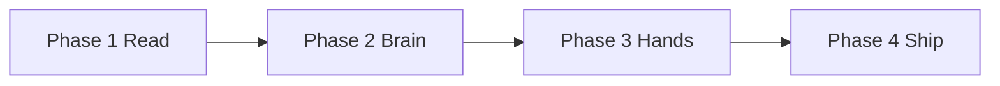

# Sahayak — Phase-wise Implementation Plan

This document turns [problem-statement.md](./problem-statement.md) and [architecture.md](./architecture.md) into a **four-phase, slice-by-slice build order**. Each slice is a vertical cut (UI → service worker → content script → storage/API) small enough to implement and manually test in Cursor before moving on.

**How to use this plan**

1. Complete slices **in order** within a phase unless a dependency note says otherwise.
2. After each slice, run that slice’s **Manual test** checklist on real Chrome pages.
3. Do not start agent automation (Phase 3) until IPC and Gemini paths from Phases 1–2 are stable.
4. Lock implementation choices in §0 before Slice 1 if not already decided.

**Related docs:** [architecture.md](./architecture.md) · [edge-case.md](./edge-case.md)

---

## 0. Locked defaults (resolve before coding)

| Decision | Choice for this plan | Rationale |
|----------|----------------------|-----------|
| Bundler | **Vite** + `@crxjs/vite-plugin` or manual multi-entry | Fast MV3 builds for panel, SW, content |
| UI | **React** in side panel | Matches architecture module list; good streaming UX |
| Validation | **Zod** | Agent / find-it JSON + safety gates |
| Settings | **In-panel Settings tab** (no separate options page v1) | Single source of truth per architecture |
| Practice sites | **`shared/config/practice-origins.ts`** | Agent allowlist; update with cohort URLs |

Add a `.env.example` with placeholder names only; real keys via Settings → `chrome.storage.local`.

---

## Phase map

| Phase | Calendar | Theme | Outcome |
|-------|----------|-------|---------|
| **Phase 1** | Week 1 | Read & summarise | Loadable extension; explain selection; article + YouTube summary; EN/Hinglish |
| **Phase 2** | Week 2 | Page brain + screen | Grounded chat; context menu; screenshot Q&A; resilient AI |
| **Phase 3** | Week 3 | Hands with approval | Scanner, badges, find-it, agent loop, logs, practice tasks |
| **Phase 4** | Week 4 | Memory, safety, ship | Profile, skills, safety hardening, README, release, Pages |

---

## Cross-cutting work (all phases)

| Item | When | Owner surface |
|------|------|----------------|
| `src/shared/messages.ts` typed IPC | Slice 1.2+ | Panel ↔ SW ↔ CS |
| `requestId` + error replies on all messages | Slice 1.2 | Shared |
| Tab binding + “context switched” banner | Slice 1.2 | Panel + SW |
| Trust boundary: no keys/profile/model output in page | Every slice | CS must never store/fetch LLM |
| `.gitignore` for `dist/`, `.env`, keys | Slice 1.1 | Repo |

---

# Phase 1 — Foundation & summarisation (Week 1)

**Objective:** Chrome MV3 shell, settings, first Gemini calls from side panel, Readability pipeline, structured summaries, language toggle.

**Maps to problem statement:** Extension foundation, first AI interaction, article/YouTube summarisation, language toggle.

**Phase 1 exit (acceptance):** Extension loads; side panel opens; API key in settings; explain selection; article summary structure; public YouTube summary; English/Hinglish works.

---

### Slice 1.1 — Extension shell + side panel + settings

**Goal:** User can load unpacked extension and open side panel with Settings for Gemini API key.

**Tasks**

1. Scaffold repo: `manifest.json` (MV3), `sidePanel`, `background` service worker, minimal content script registration.
2. Vite (or chosen bundler) outputs: `sidepanel.js`, `background.js`, `content.js`.
3. Side panel shell: header, nav tabs (Home, Settings), empty states.
4. Settings: save/load `geminiApiKey` via `chrome.storage.local`; validate non-empty before AI features.
5. Background: `chrome.sidePanel.setPanelBehavior({ openPanelOnActionClick: true })`, install listener stub.
6. README stub: Load unpacked steps, permissions list.

**Key files**

- `manifest.json`
- `src/sidepanel/App.tsx`, `src/sidepanel/views/Settings.tsx`
- `src/background/index.ts`
- `src/content/index.ts` (ping-only)
- `.gitignore`, `.env.example`

**Manual test**

- [ ] Load unpacked in Chrome; no console errors in SW/panel.
- [ ] Click extension icon → side panel opens beside a normal tab.
- [ ] Save API key → reload extension → key still present.
- [ ] Confirm no API key string in repo.

**Done when:** Week 1 criteria items “loads”, “side panel opens”, “API key through settings” pass.

---

### Slice 1.2 — IPC skeleton + tab context

**Goal:** Panel requests page data through service worker → content script; tab id tracked.

**Tasks**

1. Define `shared/messages.ts`: `PING`, `GET_ACTIVE_TAB`, `CS_PING`, error envelope `{ requestId, ok, error? }`.
2. SW message router: forward page requests to tab’s content script.
3. Content script: respond to `CS_PING` with `{ url, title }`.
4. Panel: on mount, resolve active tab; show tab title/url; banner placeholder for tab switch.
5. Inject content script via manifest `content_scripts` + `scripting` fallback if needed.

**Manual test**

- [ ] Panel shows current tab title after open.
- [ ] Switch tab → banner prompts refresh; refresh updates context.

**Done when:** Reliable round-trip message in &lt;500 ms on static page.

---

### Slice 1.3 — Gemini text call (panel)

**Goal:** Side panel calls Gemini Flash-Lite with user key; displays result.

**Tasks**

1. `shared/ai/providers/gemini-text.ts` — `fetch` to Gemini REST (or SDK) usable from extension pages.
2. `shared/ai/router.ts` — stub `route(taskType, { caller: 'panel' })`.
3. `shared/prompts/system.ts` — base assistant role.
4. Panel “Try connection” or dev button: send test prompt; show loading/error/success.

**Manual test**

- [ ] Invalid key → friendly error in panel (no crash).
- [ ] Valid key → response renders in panel.

**Done when:** Panel-only Gemini path works per architecture diagram (SP → Gemini).

---

### Slice 1.4 — Explain selected text

**Goal:** User selects text on page; Sahayak explains it in the side panel.

**Tasks**

1. Panel UI: text area pre-filled from selection + “Explain” (v1: paste selection; v1.5: “Use selection” button).
2. SW: `GET_SELECTION` via `chrome.scripting.executeScript` on active tab.
3. Prompt template `explain-selection.ts`; call Gemini from **panel** with selection + language pref.
4. Render markdown/plain result in panel.

**Manual test**

- [ ] Select paragraph on news article → Explain → readable plain-language answer in panel.

**Done when:** Week 1 “selected text can be explained” passes.

---

### Slice 1.5 — Article extraction (Readability)

**Goal:** Content script extracts article JSON; panel receives it via SW.

**Tasks**

1. Bundle `@mozilla/readability` + `jsdom` alternative: run Readability in content script on cloned document.
2. Message `GET_PAGE_ARTICLE` → `{ title, byline, excerpt, textContent, siteName, length }`.
3. Truncate helper in `shared/text/truncate.ts` with `[truncated]` marker.
4. Panel “Summarise this page” button enabled when `length > threshold`.

**Manual test**

- [ ] BBC/MDN-style article → extraction excludes obvious nav noise.
- [ ] Non-article (e.g. Google search) → graceful “no article detected”.

---

### Slice 1.6 — Article summarisation (structured)

**Goal:** TL;DR, five key points, what to do next.

**Tasks**

1. Prompt `summarize-article.ts` with required headings/sections.
2. Panel renders structured sections (not one blob only).
3. Optional: ask model for JSON + map to UI for consistent layout.

**Manual test**

- [ ] Full structure visible on 2+ different article sites.

**Done when:** Week 1 article summarisation criterion passes.

---

### Slice 1.7 — Public YouTube summarisation

**Goal:** User pastes or uses current tab watch URL; structured summary + optional timestamp links.

**Tasks**

1. Detect `youtube.com/watch` URL from tab or input.
2. Panel calls Gemini with YouTube URL when API supports it; else fallback message + title/description only.
3. UI: clickable `&t=` timestamp links when chapters returned.

**Manual test**

- [ ] Public lecture/video URL → useful summary.
- [ ] Private/unlisted → clear “unsupported” message.

---

### Slice 1.8 — English / Hinglish toggle

**Goal:** Global output language affects all Phase 1 AI outputs.

**Tasks**

1. Storage key `outputLanguage: 'en' | 'hinglish'`.
2. Settings + header toggle; persist on change.
3. Inject language block into every panel-side prompt via `shared/prompts/language.ts`.

**Manual test**

- [ ] Same article summarised in EN vs Hinglish; tone clearly differs.

**Phase 1 stretch (optional):** Chrome built-in Prompt API for offline summarise — separate branch; not required for exit.

---

# Phase 2 — Page brain & screen (Week 2)

**Objective:** Grounded page chat, context menus, screenshot Q&A, free-tier resilience (Groq fallback on panel).

**Phase 2 exit:** Page chat grounded; Explain/Translate/Draft from context menu; screenshot question works; 429/errors don’t crash.

---

### Slice 2.1 — Grounded page chat (MVP)

**Goal:** Chat UI with page text as context; history for session.

**Tasks**

1. Panel chat view: message list, input, send.
2. On first message (or “Refresh context”): `GET_PAGE_ARTICLE` or `GET_PAGE_TEXT_SNAPSHOT` via SW/CS.
3. System prompt: answer only from context; say if not on page.
4. Panel → Gemini; include last N turns in request.

**Manual test**

- [ ] Question answerable from page → correct.
- [ ] Question not on page → explicit “not found on this page”.

---

### Slice 2.2 — Streaming chat responses

**Goal:** Token stream into panel when Gemini streaming available.

**Tasks**

1. Implement `stream` on Gemini provider or SSE parsing.
2. Panel incremental render + cancel button.
3. Fallback: non-streaming complete call if stream fails.

**Manual test**

- [ ] Long answer visibly streams; cancel stops UI update.

---

### Slice 2.3 — Context menu: Explain / Translate / Draft

**Goal:** Right-click selection → side panel opens with action prefilled.

**Tasks**

1. SW `contextMenus.create` on install for three items.
2. On click: get selection, `chrome.sidePanel.open({ tabId })`, send runtime message to panel `{ type: 'QUICK_ACTION', action, text, tabId }`.
3. Prompts: `translate-selection.ts`, `draft-reply.ts`; panel runs Gemini.
4. Translate target: Hindi default + setting for other language later.

**Manual test**

- [ ] Each menu item on selected email paragraph → correct mode in panel with result.

---

### Slice 2.4 — Screenshot-and-ask (full tab v1)

**Goal:** Capture visible tab; user asks vision question; answer in panel.

**Tasks**

1. SW handler `CAPTURE_VISIBLE_TAB` → `chrome.tabs.captureVisibleTab` JPEG/PNG base64.
2. Panel: “Capture & ask” flow; question input; send image + question to **SW** → Gemini Flash vision (per architecture: worker-owned vision).
3. Display answer in panel only (never inject into page DOM).

**Manual test**

- [ ] Page with chart/diagram → question about visual detail answered sensibly.

**Stretch:** Crop/focus region before send (Slice 2.4b) — defer if time-boxed.

---

### Slice 2.5 — AIRouter resilience + Groq fallback

**Goal:** 429/5xx handled; panel falls back to Groq for text-only tasks.

**Tasks**

1. Settings: optional `groqApiKey`.
2. Extend `AIRouter`: retry with backoff; chain Lite → Flash → Groq (`caller: 'panel'` only).
3. UI error component: rate limit, retry timer, “switching fallback”.
4. Ensure SW Gemini calls have separate timeout/retry (no Groq).

**Manual test**

- [ ] Simulate bad key / mock 429 → panel shows error, no SW crash.
- [ ] With Groq key, force Gemini failure on Explain → Groq succeeds.

**Phase 2 regression:** Re-run Phase 1 summarise + explain flows under router.

---

# Phase 3 — Hands with approval (Week 3)

**Objective:** Interactive scanner, numbered badges, find-it JSON, approval agent loop, persistence, action log, two practice errands.

**Phase 3 exit:** All Week 3 acceptance criteria in problem statement.

---

### Slice 3.1 — Interactive element scanner

**Goal:** Content script builds numbered action map.

**Tasks**

1. `content/scanner.ts`: selectors per architecture §7.1; visibility filters; innermost clickable preference.
2. Stable ids 1..N; in-memory `id → WeakRef/element` map (rebuild on refresh).
3. Message `GET_ACTION_MAP` returns `{ mapVersion, elements[] }`.
4. Mask password fields as blocked entries (basic; full rules Phase 4).

**Manual test**

- [ ] Form-heavy practice page → sensible N elements; buttons/inputs present.

---

### Slice 3.2 — Numbered badges overlay

**Goal:** Visual numbers on page; toggle in panel.

**Tasks**

1. `content/overlay.ts`: shadow DOM badges positioned with `getBoundingClientRect`.
2. Scroll/resize throttle via `requestAnimationFrame`.
3. Messages: `SHOW_BADGES`, `HIDE_BADGES`.

**Manual test**

- [ ] Badges align roughly with controls; hide/show works.

---

### Slice 3.3 — Find-it-for-me (structured JSON)

**Goal:** NL query → highlight element; no click.

**Tasks**

1. Zod schema `FindElementResponse`: `{ targetId, reason }`.
2. SW: fetch action map, call **Gemini** with compact JSON list; validate response.
3. CS: `HIGHLIGHT_ELEMENT { targetId }` scroll + pulse.
4. Panel: input + result card showing number and reason.

**Manual test**

- [ ] “Where do I upload resume?” on practice form → correct highlight.

---

### Slice 3.4 — Agent FSM + proposal UI (no execute yet)

**Goal:** User starts task; sees proposed JSON action; Approve/Skip/Stop UI without DOM execution.

**Tasks**

1. SW `agent/fsm.ts`: states Idle, Planning, AwaitingApproval, Executing per architecture §8.1.
2. Prompt `agent-next-step.ts`; Zod `AgentAction` union.
3. SW Gemini call returns single next action; store `pendingProposal`.
4. Panel: task input, proposal card (type, target, value, reason), Approve / Skip / Stop, step counter, max steps setting.

**Manual test**

- [ ] Start task → proposal appears; Stop returns to Idle; Skip requests new proposal.

---

### Slice 3.5 — SafetyEngine v1 (execute gates)

**Goal:** Block illegal proposals before execute.

**Tasks**

1. `shared/safety/`: URL blocklist stub, field policy (password, OTP heuristics), consequential label regex.
2. `SafetyEngine.evaluate()` → allow | block | requireExtraConfirm.
3. Blocked proposals shown in panel with reason; log entry `blocked`.

**Manual test**

- [ ] Proposal targeting password field → blocked in UI.

---

### Slice 3.6 — Action executor (content script)

**Goal:** Approved actions only: click, type, select, scroll, done.

**Tasks**

1. `content/executor.ts` resolves targetId from current map; implements actions per architecture §8.3.
2. SW: on Approve → safety pass → `EXECUTE_ACTION` to CS → result ack.
3. Refresh action map + increment `mapVersion` after execute.

**Manual test**

- [ ] Approved click on practice button → page reacts; no action on Skip.

---

### Slice 3.7 — Agent controls: dry-run, step limit, extra confirm

**Goal:** Dry-run highlights only; max steps; double confirm on Submit/Pay/Send.

**Tasks**

1. Dry-run path: `EXECUTE_DRY_RUN` → highlight pulse only.
2. Enforce `maxSteps` from settings; auto Idle with message.
3. Modal for `requireExtraConfirm` even after Approve.

**Manual test**

- [ ] Dry-run never navigates/submits; step limit stops loop; Submit requires second confirm.

---

### Slice 3.8 — Persistence + action log

**Goal:** Survive service worker sleep; log visible in panel.

**Tasks**

1. Persist `agentSession:{tabId}` to `chrome.storage.local` on each transition.
2. Panel on load: `GET_AGENT_SESSION` → restore UI if AwaitingApproval.
3. `ActionLogEntry[]` in session; panel Action log tab.

**Manual test**

- [ ] Approve flow mid-task → terminate SW in chrome://serviceworker → reopen panel → state restored.

---

### Slice 3.9 — Practice origins allowlist + two errands

**Goal:** Agent enabled only on practice sites; complete two full tasks with per-step approval.

**Tasks**

1. `PRACTICE_ORIGINS` in config; SW checks before `USER_START_TASK`.
2. Document two cohort scenarios in README (internship form, shop filters, or multi-page table—pick two achievable).
3. End-to-end manual scripts for graders.

**Manual test**

- [ ] Agent start on blocked URL (e.g. bank homepage) → refused.
- [ ] Two practice flows complete with approval every step; log complete.

---

# Phase 4 — Memory, safety, shipping (Week 4)

**Objective:** Profile, skills import/export, full safety rails, packaging, docs, GitHub Pages.

**Phase 4 exit:** All Week 4 acceptance criteria + Definition of Done §9 in problem statement.

---

### Slice 4.1 — Local profile memory

**Goal:** Profile in storage; used for draft/fill flows.

**Tasks**

1. `UserProfile` schema + Settings/Memory UI form.
2. Wire profile into `draft-reply` and agent fill instructions when user invokes “Fill from profile” skill or agent task type.
3. Never expose profile to content script or page.

**Manual test**

- [ ] Save profile → draft reply mentions consistent name/tone; reload persists.

---

### Slice 4.2 — One-click skills

**Goal:** Create, run, list skills on current page.

**Tasks**

1. Storage `skills: Skill[]`; CRUD UI in panel.
2. Template variables: `{{pageText}}`, `{{selection}}`, `{{profile.name}}`, etc.
3. Run skill: gather context via IPC → panel or SW text route per skill type.

**Manual test**

- [ ] “Explain in Hinglish” skill on article → expected output.

---

### Slice 4.3 — Skills export / import

**Goal:** JSON file `{ version: 1, skills: [] }`.

**Tasks**

1. Export: download blob from panel.
2. Import: file picker, validate version, merge or replace with user choice.

**Manual test**

- [ ] Export → clear storage → import → skills restored.

---

### Slice 4.4 — Safety rails hardening

**Goal:** All problem-statement Week 4 safety rules enforced in code.

**Tasks**

1. Expand URL blocklist (banking, payment, UPI, wallet); unit tests.
2. Field policy: OTP/card autocompletes; strip from type targets in action map.
3. Sensitive page warning before cloud send (read-only features)—optional modal.
4. Agent: refuse login/payment/OTP automation attempts in executor + FSM.
5. Kill switch: Stop tears down badges, clears session, documented shortcut.

**Manual test**

- [ ] Full checklist from problem statement §Week 4 safety (manual + unit tests for pure functions).

---

### Slice 4.5 — API key hygiene + repo hardening

**Goal:** No keys in git; contributor-safe defaults.

**Tasks**

1. `.gitignore`, CI or pre-commit grep for `AIza` / Groq patterns.
2. README security section; issue template reminder.

**Manual test**

- [ ] Fresh clone contains no secrets; grep script passes.

---

### Slice 4.6 — README, screenshots, release ZIP

**Goal:** Another user can install from GitHub Release.

**Tasks**

1. README: features, permissions, API key setup, practice URLs, safety limitations.
2. Screenshots in `docs/screenshots/`.
3. Build script `npm run build` → zip `dist/` as `sahayak-vX.Y.Z.zip`.
4. GitHub Release with attached ZIP (manual or workflow on tag).

**Manual test**

- [ ] Teammate loads ZIP unpacked on clean profile → Phase 1–2 smoke test passes.

---

### Slice 4.7 — GitHub Pages landing page

**Goal:** One-page marketing/docs site.

**Tasks**

1. Static `docs/index.html` or VitePress/GitHub Pages from `/docs`.
2. Link to repo, release, demo screenshots, non-goals (no autonomous banking, etc.).

**Manual test**

- [ ] Pages URL loads; install link works.

---

### Slice 4.8 — Definition of Done audit

**Goal:** Trace problem statement §9 workflow end-to-end.

**Tasks**

1. Run DoD script (manual 12-step checklist from problem statement).
2. Fix gaps; update `edge-case.md` with any discovered issues.

**Done when:** All 12 DoD bullets verified on Chrome desktop.

---

## Slice index (quick reference)

| # | Slice | Phase |
|---|--------|-------|
| 1.1 | Extension shell + settings | 1 |
| 1.2 | IPC + tab context | 1 |
| 1.3 | Gemini text (panel) | 1 |
| 1.4 | Explain selection | 1 |
| 1.5 | Readability extraction | 1 |
| 1.6 | Article summary | 1 |
| 1.7 | YouTube summary | 1 |
| 1.8 | EN / Hinglish | 1 |
| 2.1 | Page chat | 2 |
| 2.2 | Streaming chat | 2 |
| 2.3 | Context menus | 2 |
| 2.4 | Screenshot-and-ask | 2 |
| 2.5 | Router + Groq fallback | 2 |
| 3.1 | Element scanner | 3 |
| 3.2 | Badges | 3 |
| 3.3 | Find-it | 3 |
| 3.4 | Agent FSM + proposal UI | 3 |
| 3.5 | SafetyEngine v1 | 3 |
| 3.6 | Executor | 3 |
| 3.7 | Dry-run, limits, extra confirm | 3 |
| 3.8 | Persistence + action log | 3 |
| 3.9 | Practice allowlist + 2 errands | 3 |
| 4.1 | Profile | 4 |
| 4.2 | Skills CRUD | 4 |
| 4.3 | Skills import/export | 4 |
| 4.4 | Safety hardening | 4 |
| 4.5 | Key hygiene | 4 |
| 4.6 | README + release ZIP | 4 |
| 4.7 | GitHub Pages | 4 |
| 4.8 | DoD audit | 4 |

This order matches problem statement §10 (slices 1–17 grouped into phases above).

---

## Functional requirements traceability

| FR | Delivered in |
|----|----------------|
| FR-1 Side panel | Slice 1.1 |
| FR-2 Settings | Slice 1.1, 1.8, 2.5, 4.1 |
| FR-3 Content extraction | Slice 1.5 |
| FR-4 Summarisation | Slices 1.6, 1.7 |
| FR-5 Grounded page chat | Slices 2.1–2.2 |
| FR-6 Visual understanding | Slice 2.4 |
| FR-7 Structured agent JSON | Slices 3.3–3.4 |
| FR-8 Human approval | Slices 3.4–3.6 |
| FR-9 Local memory | Slices 4.1–4.3 |
| FR-10 Safety in code | Slices 3.5, 4.4 |

---

## Suggested weekly schedule (timeboxing)

| Week | Focus slices | Buffer |
|------|----------------|--------|
| 1 | 1.1 → 1.8 | Polish UI; optional Chrome AI stretch |
| 2 | 2.1 → 2.5 | 2.4b crop if time |
| 3 | 3.1 → 3.9 | Second practice errand rehearsal |
| 4 | 4.1 → 4.8 | Release candidate day before deadline |

---

## Cursor prompt for next step

> Implement **Slice 1.1** of Phase 1 using `@docs/implementation-plan.md` and `@docs/architecture.md`. Smallest working MV3 extension only; no features beyond shell + settings + load unpacked.

---

## References

- [architecture.md](./architecture.md) — system context, IPC, agent FSM, safety pipeline
- [problem-statement.md](./problem-statement.md) — acceptance criteria and DoD
- [Google AI Studio](https://aistudio.google.com/) — Gemini API key
